# Định nghĩa bài toán T-ASR và yêu cầu của thầy — đầy đủ ký hiệu, công thức

**Nguồn đã đọc (toàn bộ):** `project/readme` (yêu cầu của thầy); `Challenge_Orange_ROADEF_2026_Subject.pdf` (đề, 11 trang; sau đây gọi là **"đề"**); `calculating_r.pdf` (cách tính $r$); `json_to_graph_pluto_v2.jl` và `json_to_multigraph_pluto.jl` (hai script đọc đồ thị của thầy); dữ liệu `project/setA/` (20 instance × 3 file JSON).
**Quy ước:** mọi công thức dưới đây là của đề, trừ khi ghi rõ "(của nhóm)". Mình đổi tên **đích của nhu cầu** thành $\tau_d$ để không nhầm với thời điểm $t$ (đề dùng chữ $t$ cho cả hai).

---

## 1. Bài toán nói bằng lời


*Toàn cảnh bài toán: đầu vào → cái ta chọn (biến x) → cái ta đo (tải) → mục tiêu.*


*Mạng toy của đề: 7 router, 22 liên kết một chiều; nhãn ω;c là trọng số và dung lượng. Xanh = nguồn, cam = đích.*

Một mạng IP/MPLS có các **router** (nút) nối với nhau bằng các **liên kết có hướng** (cung), mỗi cung có **trọng số** $\omega$ (để tính đường ngắn nhất) và **dung lượng** $c$ (lượng lưu lượng tối đa). Có một tập **nhu cầu**: mỗi nhu cầu cần gửi một lượng lưu lượng từ một nút nguồn đến một nút đích, và lượng này **thay đổi theo thời gian**.

Gói tin thông thường đi theo **đường ngắn nhất**; nếu nhiều đường ngắn nhất bằng nhau thì lưu lượng được **chia đều** (ECMP). **Segment Routing (SR)** cho phép ép gói tin đi qua một dãy **waypoint** (nút trung gian) theo thứ tự, giữa hai waypoint liên tiếp vẫn đi đường ngắn nhất. Nhờ vậy ta điều khiển được đường đi mà ít phải đổi cấu hình mạng.

Có một **kịch bản bảo trì**: tại một số thời điểm, vài cung bị **tắt**. Có một **ngân sách** giới hạn số thay đổi cấu hình giữa hai thời điểm liên tiếp.

**Việc phải làm:** với mỗi nhu cầu và mỗi thời điểm, chọn dãy waypoint (tối đa `maxSeg` đoạn), sao cho **tải của các cung** (lưu lượng / dung lượng) **đều và nhỏ**: tối thiểu tải cung nặng nhất, rồi cung nặng thứ hai, v.v. (thứ tự từ điển), thoả ngân sách thay đổi.

---

## 2. Bảng ký hiệu đầy đủ

### 2.1. Mạng và đồ thị

| Ký hiệu | Nghĩa | Kiểu / miền | Lấy từ (JSON) |
|---|---|---|---|
| $G=(V,A)$ | đồ thị có hướng của mạng | | `*-net.json` |
| $V=\{v_0,\dots,v_{n-1}\}$ | tập nút (router); $n=\lvert V\rvert$ | | `nodes` (mỗi nút có `id`, `name`) |
| $A\subseteq\{a_{i,j}=(v_i,v_j)\in V\times V\}$ | tập cung (liên kết); $m=\lvert A\rvert$ | | `links` (mỗi cung có `id`, `from`, `to`) |
| $a_{i,j}$ | cung từ nút $v_i$ đến nút $v_j$ | | |
| $\omega:A\to\mathbb{Q}$ | **trọng số** cung, dùng để tính đường ngắn nhất | dương | `metric` |
| $c:A\to\mathbb{Q}$ | **dung lượng** (băng thông) của cung | dương | `capacity` |
| $FG(u,v)$ | **đồ thị chuyển tiếp** từ $u$ đến $v$: mọi cung nằm trên ít nhất một đường ngắn nhất (theo $\omega$) từ $u$ đến $v$ | tập con của $A$ | tính từ $G,\omega$ |
| $r(u,v,a,t)$ | **hệ số tách**: phần lưu lượng đơn vị đi từ $u$ đến $v$ chảy qua cung $a$ khi mạng ở trạng thái $G_t$ | $\ge 0$; $=0$ nếu $a\notin FG(u,v)$ | tính (mục 4) |
| $\lambda(a,t)$ | **tải** (độ sử dụng) của cung $a$ tại thời điểm $t$ | $\ge 0$ (có thể $>1$ nếu nghẽn) | tính (mục 3.9) |
| $\mathrm{mlu}$ | **Maximum Link Utilization**: tải của cung nặng nhất | | |

### 2.2. Thời gian, bảo trì, ngân sách

| Ký hiệu | Nghĩa | Ghi chú | JSON |
|---|---|---|---|
| $h\ge1$ | chiều dài **chân trời** lập kế hoạch | SetA: $h=2$ | `num_time_slots` |
| $T=\{0,1,\dots,h-1\}$ | tập các thời điểm | $t=0$ là trạng thái **bình thường** (không có sự cố) | |
| $T^*=T\setminus\{0\}$ | các thời điểm có can thiệp | SetA: $T^*=\{1\}$ | |
| $q:T^*\to 2^A$ | **kịch bản can thiệp**: $q(t)$ là tập cung bị tắt tại $t$ | một nút tắt $\Leftrightarrow$ mọi cung nối nó tắt | `interventions` (`t`, `links` = id cung) |
| $G_t$ | đồ thị $G$ chỉ giữ các cung $A\setminus q(t)$ | $G_0=G$ | |
| $\kappa:T^*\to\mathbb{N}$ | **ngân sách**: số thay đổi tối đa từ $t-1$ sang $t$ | tại $t=0$ coi như vô hạn | `budget` (`t`, `value`) |

### 2.3. Nhu cầu và Segment Routing

| Ký hiệu | Nghĩa | JSON |
|---|---|---|
| $D$ | tập nhu cầu; $\lvert D\rvert=k$ | `demands` |
| $d=(s_d,\tau_d)$ | một nhu cầu: nguồn $s_d$, đích $\tau_d$ (đề viết $(s,t)$) | `s`, `t` |
| $\nu:D\times T\to\mathbb{Q}$ | **lưu lượng** của nhu cầu $d$ tại thời điểm $t$ | `v` = mảng theo thời gian: $\nu(d,t)=$ `v[t]` |
| $\langle s,w_1,\dots,w_\ell,t\rangle$ | **đường segment** (segment path): nguồn $s$, các waypoint $w_1,\dots,w_\ell$ theo thứ tự, đích $t$ | $\ell=0$: đi thẳng theo đường ngắn nhất |
| **segment** | một cặp nút liên tiếp trong đường segment: $(s,w_1),(w_1,w_2),\dots,(w_\ell,t)$ | có $\ell+1$ segment |
| `maxSeg` | số segment tối đa của một đường, $\texttt{maxSeg}\ge2$ | `max_segments` (SetA: 6) |
| $P=\{p_d:d\in D\}$ | **sơ đồ định tuyến** (routing scheme): mỗi nhu cầu một đường segment | |
| $\delta(p_d,ij)$ | $=1$ nếu đường $p_d$ chứa segment $(i,j)$, ngược lại $0$ | |
| $\mathrm{dist}(P,P')$ | **khoảng cách** giữa hai sơ đồ (số thay đổi) | mục 3.8 |

### 2.4. Biến quyết định

| Ký hiệu | Nghĩa | Miền |
|---|---|---|
| $x^{dt}_{ij}$ | $=1$ nếu đường segment của nhu cầu $d$ tại thời điểm $t$ **chứa segment $(i,j)$**, ngược lại $0$ | $\{0,1\}$, với mọi $d\in D$, $t\in T$, $i\in V$, $j\in V\setminus\{i\}$ |
| $\lambda'$ | vector tải đã sắp xếp (biến phụ trong mục tiêu): $\lambda'(i)$ là phần tử lớn thứ $i$ của $L$ | $\lambda':\{1,\dots,\lvert L\rvert\}\to\mathbb{Q}^+$ |
| $L$ | tập tải mọi cung ở mọi thời điểm: $L=\{\lambda(a,t)\mid a\in A,\ t\in T\}$ | |

### 2.5. Ký hiệu chỉ có trong `calculating_r.pdf` (cẩn thận, **trùng chữ với đề**)

| Ký hiệu | Nghĩa trong `calculating_r.pdf` | Chú ý |
|---|---|---|
| $c_a(t)$ hoặc $c_{uv}(t)$ | **độ dài** (trọng số) của cung | **Khác đề:** trong đề $c(a)$ là **dung lượng**, còn độ dài là $\omega(a)$ |
| $d_{ij}(t)$ | khoảng cách đường ngắn nhất từ $i$ đến $j$ trong $G(t)$ | |
| $\sigma_{ij}(t)$ | **số** đường ngắn nhất có hướng từ $i$ đến $j$ trong $G(t)$ | $0$ nếu không có đường |
| $\sigma^a_{ij}(t)$ | số đường ngắn nhất $i\to j$ **đi qua** cung $a$ | |
| $r_{ijat}$ | cùng ý nghĩa $r(i,j,a,t)$ của đề, nhưng định nghĩa bằng **tỉ lệ số đường** (mục 4) | thứ tự chỉ số $(i,j,a,t)$ |
| $G(t)=(V,A(t))$ | đồ thị tại thời điểm $t$ | tương ứng $G_t$ của đề |

---

## 3. Các khái niệm, từng cái một (có công thức)

### 3.1. Mạng
Bộ ba $(G=(V,A),\omega,c)$ với $G$ có hướng, $n$ nút. "Cung" và "liên kết" dùng thay nhau. Trong dữ liệu mỗi cung có `id` duy nhất; kịch bản bảo trì chỉ nói tới `id` cung.

### 3.2. Đồ thị chuyển tiếp và ECMP

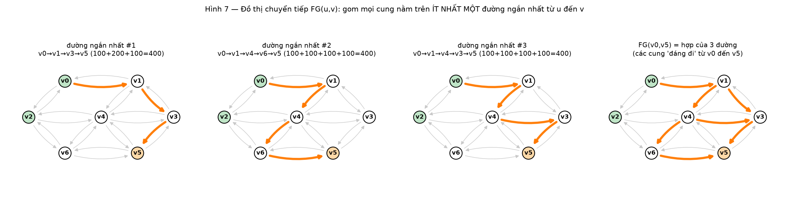

*FG(v0,v5): gom các cung nằm trên ít nhất một trong 3 đường ngắn nhất bằng nhau (cùng dài 400).*
$FG(u,v)\subseteq A$ là tập cung nằm trên **ít nhất một** đường ngắn nhất (theo $\omega$) từ $u$ đến $v$.
**ECMP (Equal-Cost Multi-Path)** theo đề: *"khi $FG(u,v)$ không phải một đường đơn, luồng đi vào một nút của $FG(u,v)$ được chia **đều** giữa các cung đi ra của nút đó trong $FG(u,v)$"*. Đây là phép chia **từng nút một** (hop-by-hop).

### 3.3. Đường segment, segment

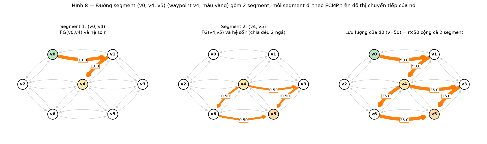

*Đường ⟨v0,v4,v5⟩ có waypoint v4 nên gồm 2 segment; mỗi segment đi theo ECMP trên đồ thị chuyển tiếp của nó.*
Đường segment là một chuỗi các đồ thị chuyển tiếp nối đuôi: đích của cái trước là nguồn của cái sau. Viết $\langle s,w_1,\dots,w_\ell,t\rangle$; nguồn và đích **không** tính là waypoint. $\ell=0$ nghĩa là chỉ đi theo $FG(s,t)$. Mỗi segment $(u,v)$ của đường được gắn với $FG(u,v)$.
**Số segment** của đường $=\ell+1$ (tính cả đoạn đầu từ nguồn tới waypoint thứ nhất và đoạn cuối từ waypoint cuối tới đích). Vì vậy $\texttt{maxSeg}$ cho phép tối đa $\texttt{maxSeg}-1$ waypoint.

### 3.4. Nhu cầu và lưu lượng
$d=(s_d,\tau_d)$ cần chuyển một lượng $\nu(d,t)\ge0$ từ $s_d$ đến $\tau_d$ tại thời điểm $t$. Nếu $\nu=1$ gọi là nhu cầu đơn vị. Lưu lượng có thể bằng $0$ ở một số thời điểm.

### 3.5. Sơ đồ định tuyến
Với $D=\{(s_i,t_i):i=1..k\}$, một sơ đồ định tuyến là $P=\{p_d:d\in D\}$, $p_d$ là một đường segment từ $s_d$ đến $\tau_d$. Ở bài toán nhiều thời điểm có một sơ đồ $P^t$ cho mỗi $t$.

### 3.6. Chân trời và can thiệp

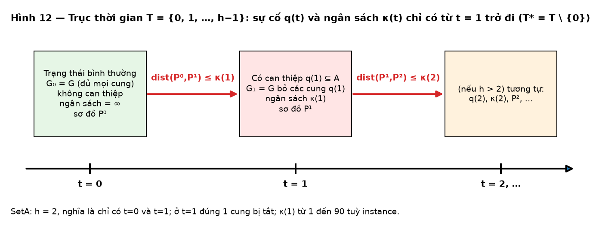

*Trục thời gian: t=0 bình thường; từ t=1 có cung bị tắt q(t) và ngân sách κ(t) giới hạn số thay đổi giữa hai thời điểm liên tiếp.*
$T=\{0,\dots,h-1\}$. Ví dụ $T=\{0,\dots,6\}$ cho kế hoạch hằng ngày trong một tuần. $t=0$ là trạng thái danh định (không sự cố), nên $T^*=T\setminus\{0\}$. Một can thiệp tắt một liên kết (hoặc một nút) trong một khoảng thời gian; về chức năng giống sự cố nhưng được **lên lịch trước**.

### 3.7. Ngân sách
Mỗi lần đổi cấu hình (thêm/bớt waypoint) tốn công của con người, nên giới hạn số thay đổi: $\kappa(t)$ là số thay đổi tối đa từ bước $t-1$ sang $t$.

### 3.8. Khoảng cách giữa hai sơ đồ


*Mỗi hộp là một segment (cũng là một biến x). dist = số hộp chỉ có ở một trong hai lộ trình.*
$$\mathrm{dist}(P,P')=\sum_{d\in D,\ i,j\in V,\ i\ne j}\bigl|\delta(p_d,ij)-\delta(p'_d,ij)\bigr|.$$
Tức là số segment có mặt ở sơ đồ này mà vắng ở sơ đồ kia, cộng trên mọi nhu cầu. Ví dụ của đề (Bảng 1), mình đã kiểm lại từng dòng:

| $P$ | $P'$ | $\mathrm{dist}$ | Giải thích |
|---|---|---|---|
| $\{\langle s,w,t\rangle\}$ | $\{\langle s,t\rangle\}$ | 3 | segment $(s,w),(w,t)$ vs $(s,t)$: 3 khác nhau |
| $\{\langle s,w_1,w_2,t\rangle\}$ | $\{\langle s,w_1,t\rangle\}$ | 3 | $(w_1,w_2),(w_2,t)$ vs $(w_1,t)$ |
| $\{\langle s,w_1,w_2,t\rangle\}$ | $\{\langle s,w_2,w_1,t\rangle\}$ | 6 | cả 3 segment đều đổi |
| $\{\langle s,w_1,t\rangle\}$ | $\{\langle s,w_2,t\rangle\}$ | 4 | $(s,w_1),(w_1,t)$ vs $(s,w_2),(w_2,t)$ |
| hai nhu cầu | | $10=4+6$ | cộng theo nhu cầu |

### 3.9. Tải và MLU

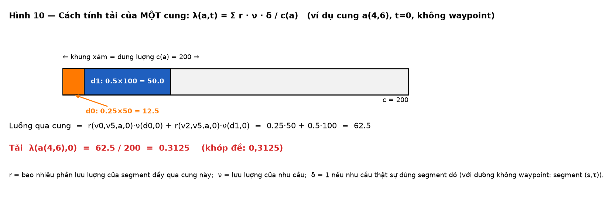

*Tính tải của cung a(4,6) ở t=0: cộng phần luồng của từng nhu cầu rồi chia cho dung lượng.*
Tải của cung $a$ tại thời điểm $t$:
$$\boxed{\ \lambda(a,t)=\frac{\sum_{d\in D}\ \sum_{i,j\in V} r(i,j,a,t)\ \nu(d,t)\ \delta(p_d,ij)}{c(a)}\ }$$
Giải thích từng thừa số: $\delta(p_d,ij)$ chọn các segment mà nhu cầu $d$ dùng; $\nu(d,t)$ là lượng lưu lượng; $r(i,j,a,t)$ là phần của lưu lượng đó đi qua $a$; chia cho $c(a)$ để ra tỉ lệ. Tải có thể lớn hơn $1$ khi cung bị nghẽn.
$$\mathrm{mlu}(P,D,G)=\max_a\lambda(a,\cdot).$$
Ví dụ của đề: $\lambda(a_{4,6},0)=\dfrac{r(v_0,v_5,a_{4,6},0)\,\nu(d_0,0)+r(v_2,v_5,a_{4,6},0)\,\nu(d_1,0)}{c(a_{4,6})}=\dfrac{0{,}25\cdot50+0{,}5\cdot100}{200}=0{,}3125.$

---

## 4. Hệ số tách $r$ — phần dễ sai nhất

### 4.1. Định nghĩa theo đề (ECMP từng nút)
$r(u,v,a,t)$ là tỉ lệ luồng giữa $u$ và $v$ đi qua $a$ khi mạng ở $G_t$; $r\ge0$ và $r=0$ nếu $a\notin FG(u,v)$. Tính bằng cách: gán luồng $1$ cho $u$; xét các nút của $FG(u,v)$ theo thứ tự khoảng cách tăng dần từ $u$; ở mỗi nút $x$, chia luồng $f_x$ **đều** cho $\lvert\mathrm{Out}_{FG}(x)\rvert$ cung đi ra:
$$r(u,v,(x,y),t)\mathrel{+}=\frac{f_x}{\lvert\mathrm{Out}_{FG}(x)\rvert},\qquad f_y\mathrel{+}=\frac{f_x}{\lvert\mathrm{Out}_{FG}(x)\rvert}.$$
Điều kiện thuộc $FG(u,v)$ (so sánh bằng nhau, nên với trọng số thực phải dùng dung sai): $\mathrm{dist}_u[x]+\omega(x,y)=\mathrm{dist}_u[y]$ và $\mathrm{dist}_u[y]+\mathrm{dist}_y[v]=\mathrm{dist}_u[v]$.

### 4.2. Công thức trong `calculating_r.pdf` (thầy yêu cầu đọc, readme Step 3)
Với cung $a=(u',v')$ (đổi ký hiệu để khỏi trùng $u,v$ của đề), hai nút $i,j$:
$$r_{ijat}=\begin{cases}\dfrac{\sigma_{iu'}(t)\ \sigma_{v'j}(t)}{\sigma_{ij}(t)}, & \text{nếu } d_{iu'}(t)+c_a(t)+d_{v'j}(t)=d_{ij}(t),\\[2mm] 0,&\text{ngược lại,}\end{cases}$$
và $r_{ijat}=0$ nếu không có đường từ $i$ đến $j$ ($\sigma_{ij}=0$). Ý nghĩa: $\sigma^a_{ij}=\sigma_{iu'}\sigma_{v'j}$ là số đường ngắn nhất $i\to j$ đi qua $a$; $r$ là **tỉ lệ số đường**. Cách tính: chạy Dijkstra từ mọi nguồn với bộ đếm số đường (Julia: `dijkstra_shortest_paths(g, i, distmx; allpaths=true)` cho `dists` và `pathcounts`); khoảng cách cập nhật khi $\ell=d(u)+c_{uv}<d(v)$ (đặt $\sigma(v)\gets\sigma(u)$), cộng dồn $\sigma(v)\gets\sigma(v)+\sigma(u)$ khi bằng nhau.

### 4.3. Hai định nghĩa **không** tương đương — ví dụ cụ thể


*Cùng ba đường ngắn nhất: ECMP chia đều từng nút (0,5 và 0,5) khác với tỉ lệ số đường (1/3 và 2/3).*
Nhu cầu $(v_0,v_5)$ của ví dụ toy có **3 đường ngắn nhất** cùng độ dài 400: $(a_{0,1},a_{1,3},a_{3,5})$, $(a_{0,1},a_{1,4},a_{4,6},a_{6,5})$, $(a_{0,1},a_{1,4},a_{4,3},a_{3,5})$.

| | cung $a_{1,3}$ | cung $a_{1,4}$ | cung $a_{4,3}$ | cung $a_{3,5}$ |
|---|---|---|---|---|
| **ECMP từng nút** (đề; Bảng 2 của đề) | $0{,}5$ | $0{,}5$ | $0{,}25$ | $0{,}75$ |
| **Đếm đường** ($\sigma_{iu'}\sigma_{v'j}/\sigma_{ij}$) | $1/3\approx0{,}333$ | $2/3\approx0{,}667$ | $1/3\approx0{,}333$ | $2/3\approx0{,}667$ |

Lý do: ECMP chia 50–50 tại $v_1$ **dù** nhánh $v_4$ có hai đường con; còn đếm đường cho nhánh $v_4$ trọng số $2/3$. Hệ quả: MLU của ví dụ cũng khác (ECMP: $0{,}4375$; đếm đường: $\approx0{,}4167$).
Trên 20 instance của SetA, hai cách **trùng nhau ở 18/20** instance; chỉ setA-18 và setA-20 có một cặp nút lệch ở mỗi thời kỳ.

**Quyết định của nhóm:** readme Step 3 ghi rõ "đọc `calculating_r.pdf` để tính $r[i,j,a,0]$", nên **bảng chính thức dùng công thức đếm đường**; code vẫn hỗ trợ ECMP để đối chiếu. Thầy chưa trả lời câu hỏi này.

### 4.4. Hệ số $r$ ở thời điểm $t\ge1$
Chạy lại toàn bộ trên $G_t$ (đã bỏ các cung $q(t)$). Cung bị tắt không nhận luồng; các đoạn không tới được trong $G_t$ bị cấm.

---

## 5. Mô hình toán học T-ASR (của đề, mục 3)

### 5.1. Biến
$x^{dt}_{ij}\in\{0,1\}$, $\forall d\in D,\ t\in T,\ i\in V,\ j\in V\setminus\{i\}$ (số biến: $\lvert D\rvert\cdot n(n-1)\cdot\lvert T\rvert$).
Nghiệm = tập các $x$ bằng $1$, tạo thành sơ đồ định tuyến $P^t$ cho mỗi $t$.

### 5.2. Các ràng buộc

**(1) Bảo toàn luồng** — mỗi nhu cầu đi trên đúng một đường segment nối nguồn với đích, tại mọi thời điểm:
$$\sum_{j\in V\setminus\{i\}}x^{dt}_{ij}-\sum_{j\in V\setminus\{i\}}x^{dt}_{ji}=\begin{cases}1,&i=s_d\\-1,&i=\tau_d\\0,&\text{còn lại}\end{cases}\qquad\forall i\in V,\ \forall d=(s_d,\tau_d)\in D,\ \forall t\in T.$$
Đọc: "số segment đi ra khỏi $i$ trừ số segment đi vào $i$" bằng $+1$ tại nguồn, $-1$ tại đích, $0$ ở nút trung gian. Ràng buộc này chỉ ép **một đường (có thể kèm chu trình rời)**; chu trình không có lợi nhưng có thể lách ngân sách, nên nhóm thêm ràng buộc bậc $\le1$ (của nhóm).

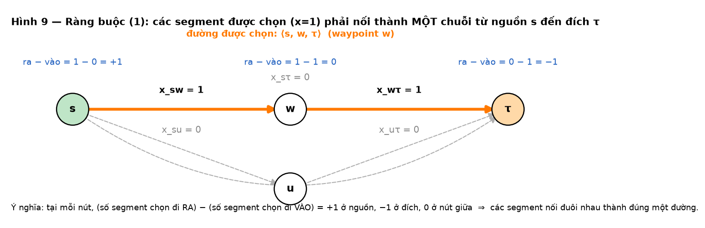

*Ràng buộc (1) trên một ví dụ: các segment chọn (x=1) nối đuôi nhau từ nguồn s đến đích τ; ra−vào = +1 / 0 / −1.*

**(2) Số segment tối đa:**
$$\sum_{i,j\in V}x^{dt}_{ij}\le\texttt{maxSeg},\qquad\forall d\in D,\ \forall t\in T.$$
Tính cả đoạn đầu (nguồn → waypoint đầu) và đoạn cuối (waypoint cuối → đích).

**(3) Ràng buộc tải** (dạng của đề):
$$\sum_{d\in D}\sum_{i,j\in V}r(i,j,a,t)\ \nu(d,t)\ x^{dt}_{ij}\ \le\ \lambda(a,t)\,c(a),\qquad\forall t\in T,\ \forall a\in A\setminus q(t).$$
Vế trái là tổng lưu lượng đi qua cung $a$; $\lambda(a,t)$ ở đây là **biến tải** bị chặn từ dưới bởi vế trái chia $c(a)$. Chỉ xét cung **không bị tắt** ($a\in A\setminus q(t)$).

**(4) Ngân sách thay đổi** (chỉ với $t\in T^*$):
$$\sum_{d\in D}\ \sum_{i,j\in V,\ i\ne j}\bigl|x^{dt}_{ij}-x^{d,t-1}_{ij}\bigr|\le\kappa(t),\qquad\forall t\in T^*.$$
Đây chính là $\mathrm{dist}(P^{t-1},P^t)\le\kappa(t)$. Dấu giá trị tuyệt đối được **tuyến tính hoá** bằng biến phụ $y^{dt}_{ij}\ge0$ (của nhóm): $y^{dt}_{ij}\ge x^{dt}_{ij}-x^{d,t-1}_{ij}$, $y^{dt}_{ij}\ge x^{d,t-1}_{ij}-x^{dt}_{ij}$, $\sum y\le\kappa(t)$.

### 5.3. Mục tiêu

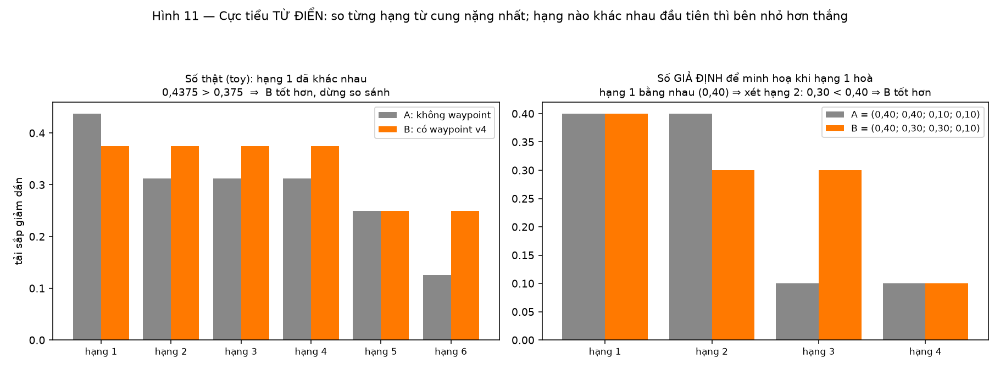

*So sánh từ điển: so từng hạng từ cung nặng nhất; hạng đầu tiên khác nhau quyết định bên nào tốt hơn.*
Cho $L=\{\lambda(a,t)\mid a\in A,\ t\in T\}$, $\lambda'(i)$ là phần tử lớn thứ $i$ của $L$:
$$\operatorname{lex\,min}\ \{\lambda'(i):1\le i\le\lvert L\rvert\}\qquad(5)$$
$$\text{với các ràng buộc }(1)\text{–}(4)\ \ (6),\qquad x^{dt}_{ij}\in\{0,1\}\ \ (7),\qquad\lambda':\{1,\dots,\lvert L\rvert\}\to\mathbb{Q}^+\ \ (8).$$
**Cực tiểu từ điển (lexicographic):** tối thiểu cung nặng nhất $\lambda'(1)$; trong các nghiệm đạt giá trị đó, tối thiểu cung nặng thứ hai $\lambda'(2)$; rồi thứ ba, v.v. Hạng đầu chính là MLU toàn thời gian.
*Chú ý (của nhóm):* đề lấy $a\in A$ (mọi cung) trong $L$, nhưng ràng buộc (3) chỉ có cho cung không bị tắt; nhóm coi các cung bị tắt **không** góp vào $L$ ở thời điểm đó.

### 5.4. Định nghĩa bài toán
**T-Adaptive Segment Routing (T-ASR).**
**Đầu vào:** mạng $(G=(V,A),\omega,c)$; tập nhu cầu $D$; lưu lượng $\nu:D\times T\to\mathbb{Q}$; chân trời $h\ge1$, $T=\{0,\dots,h-1\}$; kịch bản can thiệp $q:T^*\to2^A$; ngân sách $\kappa:T^*\to\mathbb{N}$; số segment tối đa $\texttt{maxSeg}\ge2$.
**Đầu ra:** một sơ đồ định tuyến $P^t$ cho $D$ ở mỗi $t\in T$ thoả (1)–(4) và tối thiểu hoá (5).

### 5.5. Kích thước và độ khó
Số biến nhị phân $\lvert D\rvert\,n(n-1)\,\lvert T\rvert$: từ khoảng 15 nghìn (setA-01, mỗi thời kỳ) đến gần $10^9$ (setA-20). Chỉ các instance nhỏ giải tối ưu được bằng mô hình đầy đủ.

---

## 6. Ví dụ toy trong đề (kiểm tra bằng tay được)


*Hạ tải lớn nhất từ 0,4375 xuống 0,3750 nhờ waypoint v4 (số trong ô = tải λ)*


*t=0 so với t=1: hai cung đỏ nét đứt bị tắt, lưu lượng của d0 phải đi vòng.*

**Mạng:** 7 nút (A..G, id 0..6), 22 cung có hướng; nhãn mỗi cung "$\omega(a);c(a)$". **Nhu cầu:** $d_0=(v_0,v_5)$ với $\nu(d_0,0)=50$, $\nu(d_0,1)=100$; $d_1=(v_2,v_5)$ với $\nu(d_1,0)=100$, $\nu(d_1,1)=50$. **Can thiệp:** tại $t=1$ hai cung $a_{1,3}$ và $a_{1,4}$ bị tắt (trong file toy là các `id` 2 và 3). **Cấu hình:** `max_segments` $=4$, `budget` $t=1$: $20$.

**Hệ số $r$ ở $t=0$** (Bảng 2 của đề; ECMP từng nút):

| Cung | $r(v_0,v_5,\cdot,0)$ | $r(v_2,v_5,\cdot,0)$ |
|---|---|---|
| $a_{0,1}$ | 1 | 0 |
| $a_{1,3}$ | 0,5 | 0 |
| $a_{1,4}$ | 0,5 | 0 |
| $a_{2,4}$ | 0 | 1 |
| $a_{3,5}$ | 0,75 | 0,5 |
| $a_{4,3}$ | 0,25 | 0,5 |
| $a_{4,6}$ | 0,25 | 0,5 |
| $a_{6,5}$ | 0,25 | 0,5 |
| các cung còn lại ($a_{0,2},a_{2,6},a_{4,5}$) | 0 | 0 |

**Tải:** nghiệm tầm thường (không waypoint) có $\mathrm{mlu}=0{,}4375$; dùng waypoint $v_4$ cho $d_0$ tại $t=0$ (đường $\langle v_0,v_4,v_5\rangle$) giảm MLU còn $0{,}3750$, và tải của vài cung khác **tăng** lên. Nghiệm có waypoint tốt hơn vì tải lớn nhất giảm.

---

## 7. Định dạng file và ánh xạ sang ký hiệu

### 7.1. `*-net.json` (định dạng NetworkX)
| Trường | Kiểu | Ý nghĩa / ký hiệu |
|---|---|---|
| `directed` | boolean | đồ thị có hướng |
| `multigraph` | boolean | có cho phép nhiều cung giữa cùng một cặp nút không |
| `graph` | object | (có ở 10 file SetA, rỗng) |
| `nodes[].name`, `nodes[].id` | string, integer | nhãn, id nút duy nhất ($V$) |
| `links[].id` | integer | id cung duy nhất |
| `links[].from`, `links[].to` | integer | id nút nguồn, đích ($A$) |
| `links[].metric` | float | $\omega(a)$ |
| `links[].capacity` | float | $c(a)$ |

Đề ghi: đồ thị toy **không** phải đa đồ thị. Mọi id `from`, `to` phải có trong `nodes`.

### 7.2. `*-tm.json` (ma trận lưu lượng)
`num_time_slots` $=h$; `demands[]` mỗi phần tử có `v` (mảng $\nu(d,0),\nu(d,1),\dots$), `s` (nguồn), `t` (đích). **ID của nhu cầu là vị trí trong danh sách, bắt đầu từ 0.**

### 7.3. `*-scenario.json`
`max_segments` $=\texttt{maxSeg}$; `budget[]` $\{t,\text{value}\}$ $=\kappa(t)$; `interventions[]` $\{t,\text{links}\}$ với `links` là mảng id cung bị tắt $=q(t)$. **Ở $t=0$ ngân sách coi là vô hạn và không có can thiệp**, nên $t=0$ không xuất hiện trong file.

### 7.4. Đầu ra `*-srpaths.json` (tuỳ chọn)
```json
{"srpaths": [ {"d": 0, "t": 0, "w": [3]}, {"d": 1, "t": 1, "w": [6]} ]}
```
`d` = id nhu cầu, `t` = thời điểm, `w` = danh sách id nút waypoint theo thứ tự. Nếu danh sách rỗng thì có thể bỏ dòng đó. Từ file này, bộ kiểm tra tính lại tải và MLU.

### 7.5. Hai script đọc đồ thị của thầy
- `json_to_graph_pluto_v2.jl` đọc vào đồ thị **đơn** (Graphs.jl) và **từ chối** file có `multigraph=true` (`error("... does not accept multigraph=true")`).
- `json_to_multigraph_pluto.jl` đọc vào **đa đồ thị** (`Multigraphs.jl`) và lưu `pair_to_arcs: (u,v) → danh sách cung`.
Trong SetA, 10/20 file khai báo `multigraph=true` nhưng **không file nào có cung song song** (đã kiểm tra bằng mã: 0/20 nhóm cung song song, 0 khuyên, không có trường `key` ở link nào), nên script đồ thị đơn hoàn toàn đủ nếu bỏ qua cờ.

---

## 8. Yêu cầu của thầy (`project/readme`)

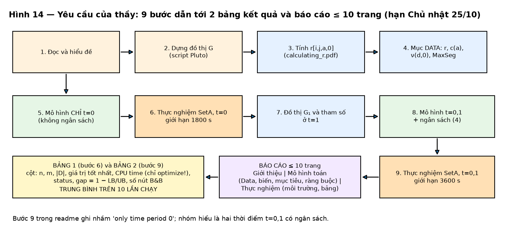

*Chín bước của thầy dẫn tới hai bảng kết quả và báo cáo ≤ 10 trang.*

### 8.1. Sản phẩm nộp (hạn **Chủ nhật 25/10**)
Báo cáo **tối đa 10 trang** gồm:
1. **Giới thiệu:** bối cảnh, động lực, mô tả bài toán.
2. **Mô hình toán học:** dữ liệu (Data), biến, mục tiêu, ràng buộc, **giải thích chi tiết**.
3. **Thực nghiệm:** mô tả các instance, **môi trường chạy code**, **bảng kết quả số**, trong đó "**báo cáo trung bình trên mười lần chạy**" của: thông tin về instance, **CPU time**, **gap**, **số nút của cây branch-and-bound**.

### 8.2. Các bước (Step 1–9)
| Bước | Việc phải làm |
|---|---|
| 1 | Đọc và hiểu đề. |
| 2 | Dùng script Pluto để dựng đồ thị $G$ ở thời điểm 0 từ file JSON. |
| 3 | Đọc `calculating_r.pdf` để tính $r[i,j,a,0]$. |
| 4 | Viết mục **Data**: tính các tham số của mô hình từ ba file JSON — $r(i,j,a,0)$ và $c(a)$ từ file net; $\nu(d,0)$ (readme viết $v(d,0)$) từ file tm; $\texttt{MaxSeg}$ từ file scenario. |
| 5 | Cài mô hình **chỉ cho thời điểm 0**, nên **không có ràng buộc ngân sách (4)**. |
| 6 | Thực nghiệm trên **SetA** chỉ ở thời điểm 0, **giới hạn 30 phút = 1800 s**; báo bảng. |
| 7 | Tạo đồ thị ở thời điểm 1 và tính tham số của thời điểm đó. |
| 8 | Mở rộng mô hình sang thời điểm 1, **thêm ràng buộc ngân sách**. |
| 9 | Thực nghiệm trên SetA, **giới hạn 1 giờ = 3600 s**; báo bảng. (Dòng đề viết "only time period 0" ở bước này nhiều khả năng là lỗi đánh máy; nhóm hiểu là hai thời điểm $t=0,1$.) |

### 8.3. Bảng kết quả (Step 6 và Step 9) phải có các cột
- số đỉnh $n$, số cung $m$, số nhu cầu $\lvert D\rvert$;
- giá trị mục tiêu **tối ưu hoặc tốt nhất** tìm được;
- **CPU time = thời gian thực hiện lời gọi `optimize!` mà thôi** (không tính dựng mô hình);
- **status:** `Optimal`, `Not Optimal` hoặc `Infeasible`;
- nếu không tối ưu, **gap** $=1.0-\dfrac{\text{cận dưới tốt nhất biết được}}{\text{giá trị nghiệm tốt nhất biết được}}$;
- số nút của cây B&B; và mọi số liệu là **trung bình 10 lần chạy**.

### 8.4. Đã sắp đặt trong đề nhưng readme không nhắc
- Đề yêu cầu cực tiểu **từ điển** (5); readme chỉ nói "Optimal or Best objective value".
- Xuất file `srpaths.json` là phần đầu ra của đề.

---

## 9. Dữ liệu SetA (đã kiểm tra)

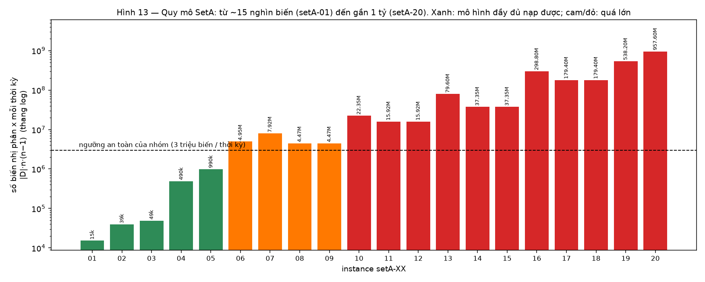

*Số biến nhị phân x mỗi thời kỳ của từng instance (thang log): từ ~15 nghìn đến gần 1 tỷ.*

20 instance, mỗi instance 3 file (`setA-XX-net/tm/scenario.json`). Tất cả: $T=\{0,1\}$ ($h=2$), $\texttt{maxSeg}=6$, **đúng một** cung bị tắt ở $t=1$, trọng số $\omega$ là số nguyên (các instance 05, 08, 12, 14 là số thực), 188 giá trị lưu lượng bằng 0.

| Instance | $n$ | $m$ | $\lvert D\rvert$ | $\kappa(1)$ | Instance | $n$ | $m$ | $\lvert D\rvert$ | $\kappa(1)$ |
|---|---|---|---|---|---|---|---|---|---|
| 01 | 20 | 80 | 40 | 51 | 11 | 200 | 1000 | 400 | 89 |
| 02 | 30 | 150 | 45 | 63 | 12 | 200 | 898 | 400 | 13 |
| 03 | 50 | 250 | 20 | 53 | 13 | 200 | 1000 | 2000 | 12 |
| 04 | 50 | 250 | 200 | 44 | 14 | 250 | 1108 | 600 | 13 |
| 05 | 100 | 396 | 100 | 1 | 15 | 250 | 1250 | 600 | 54 |
| 06 | 100 | 500 | 500 | 13 | 16 | 250 | 1452 | 4800 | 13 |
| 07 | 100 | 500 | 800 | 90 | 17 | 300 | 1270 | 2000 | 1 |
| 08 | 150 | 654 | 200 | 13 | 18 | 300 | 1500 | 2000 | 89 |
| 09 | 150 | 750 | 200 | 18 | 19 | 300 | 1998 | 6000 | 13 |
| 10 | 150 | 966 | 1000 | 1 | 20 | 400 | 2000 | 6000 | 90 |

Ngân sách $\kappa(1)$ rất khác nhau: ba instance (05, 10, 17) chỉ cho phép **1 thay đổi**, nên cấu hình ở $t=1$ gần như phải giữ nguyên.

---

## 10. Điểm mơ hồ hoặc mâu thuẫn trong đề, và cách nhóm chốt

| # | Vấn đề | Cách chốt |
|---|---|---|
| 1 | **Hai định nghĩa $r$ khác nhau** (đề: ECMP từng nút, Bảng 2; `calculating_r.pdf`: tỉ lệ số đường). Ví dụ toy: $0{,}5$ so với $2/3$ | Bảng chính thức dùng **đếm đường** (readme Step 3); ECMP chạy để đối chiếu; khác nhau chỉ ở setA-18, 20 |
| 2 | **Mục tiêu từ điển** (5) không giải trực tiếp được bằng một MILP | Nhóm tối thiểu MLU (hạng đầu) cộng một phạt rất nhỏ; có thêm `lex_topk!` (từ điển chính xác cho $K$ hạng đầu), kiểm chứng trên đồ thị nhỏ |
| 3 | $L$ lấy $a\in A$ nhưng ràng buộc (3) chỉ cho $A\setminus q(t)$ | Cung bị tắt không góp vào $L$ |
| 4 | Step 9 ghi "only time period 0" | Hiểu là $t=0,1$ có ngân sách |
| 5 | Chữ $c$ vừa là **dung lượng** (đề) vừa là **độ dài cung** (`calculating_r.pdf`) | Dùng $c(a)$ = dung lượng, $\omega(a)$ = độ dài |
| 6 | Chữ $t$ vừa là **đích** vừa là **thời điểm** (đề) | Dùng $\tau_d$ cho đích |
| 7 | Cờ `multigraph=true` ở 10 file nhưng script đồ thị đơn từ chối | Đọc JSON trực tiếp; không có cung song song thật |
| 8 | `maxSeg` đếm **segment**, không đếm waypoint | Số waypoint tối đa $=\texttt{maxSeg}-1$ |
| 9 | Đoạn $(i,j)$ không có đường trong $G_t$ | Bị cấm (không thể dùng làm segment) |
| 10 | Chu trình trong nghiệm của (1) | Thêm ràng buộc bậc $\le1$ và, nếu cần, ràng buộc khử chu trình |
| 11 | "Trung bình 10 lần chạy" với solver tất định | Dùng `random_seed` khác nhau cho mỗi lần; nghiệm tốt nhất ghi trong bảng |

---

## 11. Danh sách kiểm tra yêu cầu của thầy

- [ ] Mô hình JuMP đúng (1)–(4), biến nhị phân (7), mục tiêu (5).
- [ ] Mục Data: $r$ (theo `calculating_r.pdf`), $c(a)$, $\nu(d,0)$, $\texttt{MaxSeg}$, cùng $\kappa$ và $q$ ở $t=1$.
- [ ] Bảng 1: SetA, $t=0$, 1800 s, đủ cột, 10 lần chạy.
- [ ] Bảng 2: SetA, $t=0,1$ có ngân sách, 3600 s, đủ cột, 10 lần chạy.
- [ ] CPU time = chỉ `optimize!`; status theo ba nhãn của thầy; gap $=1-LB/UB$.
- [ ] Báo cáo $\le10$ trang với ba phần (Giới thiệu, Mô hình, Thực nghiệm), có mô tả môi trường chạy.
- [ ] (Tuỳ chọn) xuất `srpaths.json` và kiểm tra độc lập.


---

## 12. Code hiện tại giải bài toán như thế nào, và kết quả thu được

> **Nguồn:** thư mục làm việc đang ở nhánh `kien` (code của Hùng và Trung Kiên gộp trên nền `main`) và báo cáo `BAO_CAO_KET_QUA_2026-10-24/BAO_CAO.md` của nhánh đó (đợt chạy chính thức trên server 24/10/2026). Phần đối chiếu với đợt chạy trên máy M1 (nhánh `feature/tasr`/`main`) nằm ở mục 12.7. Các số trong mục này lấy từ các file đó, không phải ước lượng.

### 12.1. Code giải bài toán theo trình tự nào

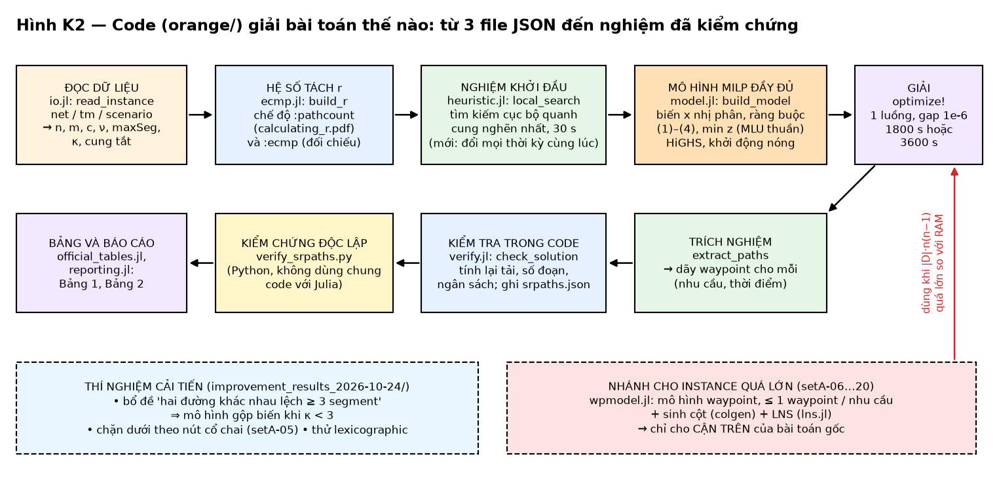

*Hình K2 — Đường đi chính (hàng trên rồi hàng giữa): đọc JSON → tính hệ số $r$ → nghiệm khởi đầu bằng heuristic → MILP đầy đủ → giải → trích nghiệm → tự kiểm tra → kiểm chứng độc lập bằng Python → bảng. Hai khung nét đứt ở dưới là nhánh cho instance quá lớn và các thí nghiệm cải tiến.*

| Bước | File / hàm (trong `orange/`) | Việc làm |
|---|---|---|
| 1. Đọc dữ liệu | `src/io.jl`: `read_instance` | Đọc ba file JSON (bỏ qua cờ `multigraph`, tự kiểm tra không có cung song song), cho ra $n$, $m$, $c(a)$, $\omega(a)$, $\nu(d,t)$, $\texttt{maxSeg}$, $\kappa(t)$, các cung bị tắt |
| 2. Hệ số tách | `src/ecmp.jl`: `build_r` | Hai chế độ: **`:pathcount`** (công thức `calculating_r.pdf`, dùng cho bảng chính thức) và `:ecmp` (từng nút, để đối chiếu) |
| 3. Nghiệm khởi đầu | `src/heuristic.jl`: `local_search` | Tìm kiếm cục bộ quanh cung nghẽn nhất (giới hạn 30 s) làm nghiệm khởi đầu cho solver. **Mới:** thêm bước đổi đồng thời mọi thời kỳ, có kiểm tra ngân sách |
| 4. Mô hình | `src/model.jl`: `build_model` | MILP đúng đề: biến $x^{dt}_{ij}$ nhị phân, ràng buộc (1)–(4), mục tiêu chính thức **tối thiểu $z$ (MLU thuần)**; khởi động nóng bằng nghiệm bước 3; tắt presolve khi mô hình rất lớn |
| 5. Giải | HiGHS, `optimize!` | 1 luồng, `mip_rel_gap` $=10^{-6}$, giới hạn 1800 s (P1) hoặc 3600 s (P2), `random_seed` = số thứ tự lần chạy |
| 6. Trích và tự kiểm tra | `extract_paths`, `src/verify.jl`: `check_solution` | Chuyển $x$ thành dãy waypoint; tính lại tải, số đoạn, ngân sách; ghi `srpaths.json` và file tải |
| 7. Kiểm chứng độc lập | `scripts/verify_srpaths.py` | Python, không dùng chung code với Julia: tính lại $r$, tải, MLU, ngân sách từ file nghiệm |
| 8. Bảng và báo cáo | `scripts/official_tables.jl`, `src/reporting.jl` | Gộp 10 lần chạy thành một dòng bảng; chỉ nhận mẫu đủ 10 lần |
| Nhánh cho instance lớn | `src/wpmodel.jl`, `src/lns.jl` | Mô hình waypoint $\le1$ waypoint/nhu cầu + sinh cột + LNS; **chỉ cho cận trên** của bài toán gốc |

**Quyết định thiết kế đáng nhớ:** (a) $r$ theo đếm đường (readme Step 3); (b) mục tiêu chính thức là MLU thuần, chính là **hạng đầu của mục tiêu từ điển** (5); (c) mọi nghiệm đều được **kiểm chứng độc lập** trước khi vào bảng; (d) đo "CPU time" chỉ ở lời gọi `optimize!`.

### 12.2. Cách làm thực nghiệm

| Hạng mục | Giá trị (đợt chính thức 24/10) |
|---|---|
| Máy | VM Ubuntu 24.04, Xeon Silver 4314 (16 vCPU), 125 GiB RAM |
| Phần mềm | Julia 1.13.1, JuMP 1.32.1, HiGHS 1.15.1 |
| Quy mô | 12 cấu hình × 10 lần chạy = **120 lần chạy**, cả 120 qua kiểm chứng độc lập |
| Mô hình đầy đủ | setA-01…05, cả P1 (chỉ $t=0$, 1800 s) và P2 ($t=0,1$, 3600 s) |
| Mô hình thu gọn | setA-10 (P1) và setA-07 (P2) |
| Baseline | mọi nhu cầu đi thẳng $\langle s,t\rangle$, không waypoint |

### 12.3. Kết quả chính thức

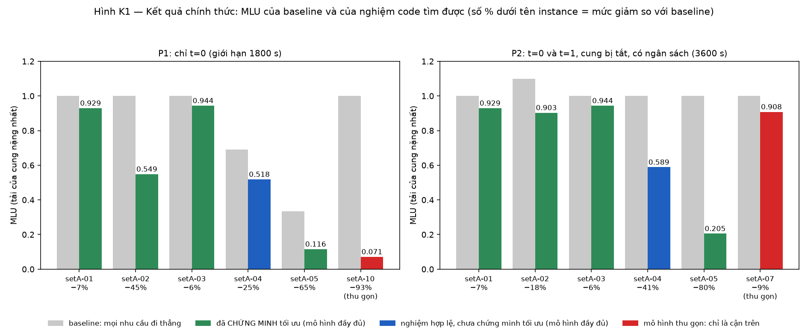

*Hình K1 — Xanh lá: đã chứng minh tối ưu; xanh dương: nghiệm hợp lệ chưa chứng minh tối ưu; đỏ: mô hình thu gọn, chỉ là cận trên.*

**P1 (chỉ $t=0$, 1800 s):**

| Instance | Baseline | **MLU** | Cận dưới | Giảm | Trạng thái | Thời gian TB / trung vị (s) |
|---|---|---|---|---|---|---|
| setA-01 | 1,0000 | **0,92938** | 0,92938 | 7,1 % | Optimal 10/10 | 0,7 / 0,7 |
| setA-02 | 1,0000 | **0,54858** | 0,54858 | 45,1 % | Optimal 10/10 | 3,7 / 3,4 |
| setA-03 | 1,0000 | **0,94354** | 0,94354 | 5,6 % | Optimal 10/10 | 32 / 5 |
| setA-04 | 0,6918 | **0,51828** | 0,45907 | 25,1 % | chưa tối ưu, gap TB 20,3 % | 1800 / 1800 |
| setA-05 | 0,3333 | **0,11552** | 0,11552 | 65,3 % | Optimal 10/10 | 149 / 145 |
| setA-10 (thu gọn) | 1,0000 | **0,07120** | – | 92,9 % | cận trên | 1801 / 1801 |

**P2 ($t=0,1$ có cung bị tắt và ngân sách, 3600 s):**

| Instance | Baseline | **MLU** | Cận dưới | Giảm | Trạng thái | Thời gian TB / trung vị (s) |
|---|---|---|---|---|---|---|
| setA-01 | 1,0000 | **0,92938** | 0,92938 | 7,1 % | Optimal 10/10 | 20,8 / 20,8 |
| setA-02 | 1,0981 | **0,90307** | 0,90307 | 17,8 % | Optimal (chứng minh ở 4/10 lần) | 2235 / 3600 |
| setA-03 | 1,0000 | **0,94354** | 0,94354 | 5,6 % | Optimal 10/10 | 760 / 727 |
| setA-04 | 1,0000 | **0,58857** | 0,58114 | 41,1 % | chưa tối ưu, gap 1,3 % | 3601 / 3601 |
| setA-05 | 0,99999 | **0,20499** | 0,20499 | 79,5 % | Optimal (chứng minh ở 5/10 lần) | 1880 / 1895 |
| setA-07 (thu gọn) | 1,0000 | **0,90799** | – | 9,2 % | cận trên | 81 / 81 |

**Tóm tắt:** 8/10 cấu hình mô hình đầy đủ được **chứng minh tối ưu**; hai cấu hình còn lại (setA-04 ở P1 và P2) có nghiệm hợp lệ nhưng chưa chứng minh.

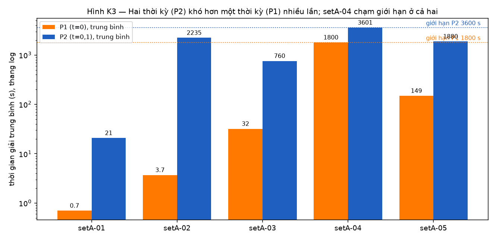

*Hình K3 — Thêm thời kỳ thứ hai làm bài toán khó hơn nhiều lần (số cột gấp khoảng 3); setA-04 chạm giới hạn ở cả hai.*

### 12.4. Đọc kết quả

1. **Waypoint giảm MLU từ 5,6 % (setA-03) đến 79,5 % (setA-05 P2).** Mức giảm phụ thuộc cấu trúc mạng: nếu điểm nghẽn nằm ở nút không có lối vòng, waypoint gần như không giúp được gì.
2. **MLU của P2 luôn $\ge$ P1** (mất một cung, lưu lượng đổi): setA-02 từ 0,549 lên 0,903; setA-05 từ 0,116 lên 0,205.
3. **Độ khó tăng theo $\lvert D\rvert\,n^2$.** setA-04 (200 nhu cầu) là bộ duy nhất chưa chứng minh được tối ưu, dù ít nút hơn setA-05.
4. **MILP chủ yếu chứng minh tối ưu cho nghiệm của heuristic.** Trong cả 100 lần chạy mô hình đầy đủ, nghiệm cuối chính là nghiệm khởi đầu của `local_search`; solver đóng góp cận dưới và chứng minh tối ưu.
5. **Kết quả phụ thuộc vào `seed`.** Ví dụ setA-05 P2: cùng mô hình, cùng nghiệm khởi đầu, LP nút gốc xong sau 1665 vòng simplex với seed 2 nhưng chưa xong sau 32 146 vòng với seed 1.

### 12.5. Hai cải tiến quan trọng nhất

**(a) setA-05 hai thời kỳ: từ 0,99999 xuống 0,20499 và chứng minh được là tối ưu.**

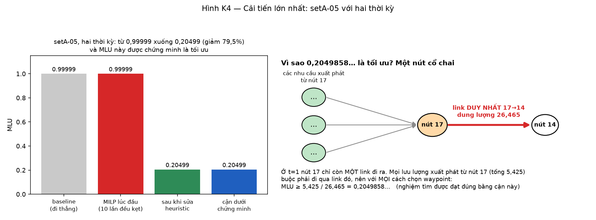

*Hình K4 — Lúc đầu cả 10 lần chạy kẹt ở 0,99999 (bằng baseline). Nguyên nhân: nhu cầu 19 đi thẳng làm đầy link 100 % ở $t=1$; heuristic cũ chỉ đổi một thời kỳ mỗi bước, mà với $\kappa=1$ mọi bước như vậy đều vượt ngân sách; solver với 2,97 triệu cột không giải xong LP nút gốc. Lời giải: cho nhu cầu đó đi qua waypoint 99 ở **cả hai** thời kỳ (tốn 0 ngân sách). Chứng minh tối ưu không cần solver: ở $t=1$ nút 17 chỉ còn một link ra (dung lượng 26,465), các nhu cầu xuất phát từ nút 17 tổng 5,425, nên $\mathrm{MLU}\ge5{,}425/26{,}465=0{,}2049858$.*

Sau khi sửa heuristic (thêm bước đổi đồng thời mọi thời kỳ), chạy lại chính thức 10 lần: cả 10 lần đều đạt 0,2049858752; 5 lần được solver chứng minh tối ưu trong 120–189 s, 5 lần còn lại hết giờ vì LP nút gốc chưa xong nhưng nghiệm vẫn đúng.

**(b) Bổ đề "hai đường khác nhau lệch $\ge3$ segment" và mô hình gộp biến.**

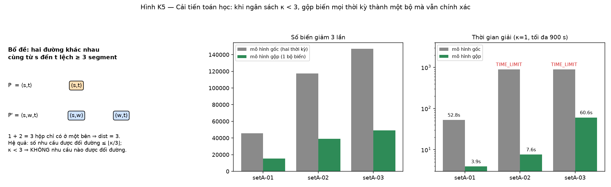

*Hình K5 — Hai đường segment hợp lệ khác nhau, cùng nguồn–đích, luôn có $\mathrm{dist}\ge3$ (chứng minh bằng cân bằng luồng tại nút; kiểm chứng vét cạn 2 882 574 cặp ở setA-01). Hệ quả: khi $\kappa<3$ không nhu cầu nào được đổi đường, nên có thể dùng **một** bộ biến cho mọi thời kỳ mà vẫn chính xác. Số biến giảm 3 lần; ở $\kappa=1$ setA-02 và setA-03 từ hết giờ xuống còn 7,6 s và 60,6 s.*

### 12.6. Mục tiêu từ điển

- Mục tiêu chính thức của bảng là **MLU thuần**, tức hạng đầu của mục tiêu từ điển (5). Các hạng sau chưa được tối ưu trong bảng.
- Công thức sắp xếp có sẵn (`exact_lexicographic_loads!`, dùng ma trận gán $L\times L$ và big-M) **thất bại ngay ở hạng 1** trên setA-01 (P1, P2) và setA-02 (P1) vì hết giờ, trong khi bài min MLU tương đương giải trong chưa đầy 1 s.
- Hướng sửa (đã đề xuất trong báo cáo và đã có `lex_topk!` trên nhánh `feature/tasr`): dùng **tổng $k$ tải lớn nhất** $\theta_k=\min\ k\,r+\sum_e\max(0,u_e-r)$, chỉ dùng biến liên tục, không cần biến gán hạng hay big-M; $\theta_1$ chính là MLU và có thể dừng sau vài hạng đầu.

### 12.7. Đối chiếu với đợt chạy trên máy M1 (nhánh `feature/tasr`)

Hai đợt chạy độc lập (máy 31,6 GB và server 125 GB) cho **cùng các giá trị tối ưu** ở mọi hàng mô hình đầy đủ giải được:

| Hàng | Server (nhánh `kien`) | Máy M1 (`feature/tasr`) | Nhận xét |
|---|---|---|---|
| setA-01…03, 05 (P1) | tối ưu 10/10 | tối ưu 10/10 | trùng đến 5 chữ số |
| setA-01…03 (P2) | tối ưu | tối ưu | trùng |
| setA-05 (P2) | 0,20499, tối ưu ở 5/10 lần, cả 10 lần đạt giá trị này | 0,20499 chỉ ở 1/9 lần (seed 7); 8 lần kẹt ở 0,99999 | **Heuristic mới của nhánh `kien` là cải tiến thật**: từ 1/9 lên 10/10 lần |
| setA-04 (P1) | 0,51828, cận dưới 0,45907 | tốt nhất 0,50105; mô hình waypoint cho 0,45912 | **tối ưu thật nằm trong [0,45907; 0,45912]**, hai kết quả của mô hình đầy đủ cao hơn khoảng 9–13 % |
| setA-04 (P2) | 0,58857, cận dưới 0,58114 | 0,58857; mô hình waypoint 0,58281 | tối ưu thật nằm trong [0,58114; 0,58281] |
| setA-06…20 | chưa chạy (chỉ setA-10 P1 và setA-07 P2 bằng mô hình thu gọn) | đủ 20 hàng bằng mô hình thu gọn (1 lần mỗi hàng) | hai đợt bổ sung cho nhau |

Hai đợt cho thấy cùng một kết luận: mô hình của thầy giải **tối ưu** được các instance nhỏ và vừa (01–03, 05), setA-04 là điểm khó nhất, còn từ setA-06 trở lên phải dùng mô hình thu gọn vì kích thước.

### 12.8. Đối chiếu với yêu cầu của thầy

| Yêu cầu | Trạng thái |
|---|---|
| Mô hình JuMP đúng đề, $r$ theo `calculating_r.pdf` | Đạt |
| Mục Data (r, $c(a)$, $\nu(d,0)$, MaxSeg) | Đạt (hàm `read_instance`, `build_r`) |
| Bảng 1 ($t=0$, 1800 s) và Bảng 2 ($t=0,1$, 3600 s) cho SetA | Đạt cho setA-01…05 với trung bình **10 lần chạy** và nghiệm kiểm chứng độc lập; setA-06…20 bằng mô hình thu gọn (cận trên), chưa đủ 10 lần |
| CPU time chỉ `optimize!`, status, gap, số nút B&B | Đạt |
| Báo cáo $\le10$ trang | Chưa có (người khác viết); đã có bản báo cáo số liệu `BAO_CAO_KET_QUA_2026-10-24/BAO_CAO.md` |

### 12.9. Còn dang dở

- setA-04 chưa chứng minh được tối ưu (cận dưới 0,45907 so với nghiệm 0,51828 ở P1); mô hình gộp biến chưa áp dụng cho nó vì $\kappa(1)=44\ge3$.
- Mục tiêu từ điển đầy đủ chưa có kết quả trên instance thật.
- setA-06…20 mới là cận trên từ mô hình thu gọn, chưa đủ 10 lần chạy.
- Heuristic mới mới chỉ được chạy lại chính thức trên setA-05 P2; các cấu hình P2 khác chưa chạy lại.
