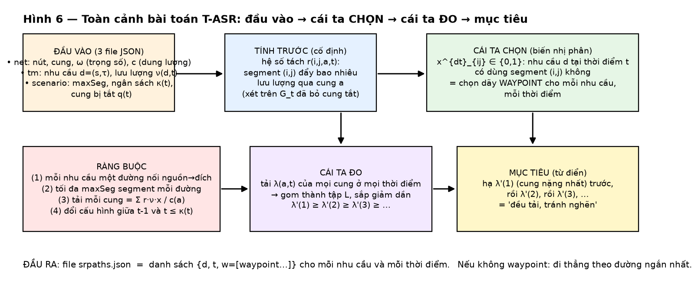
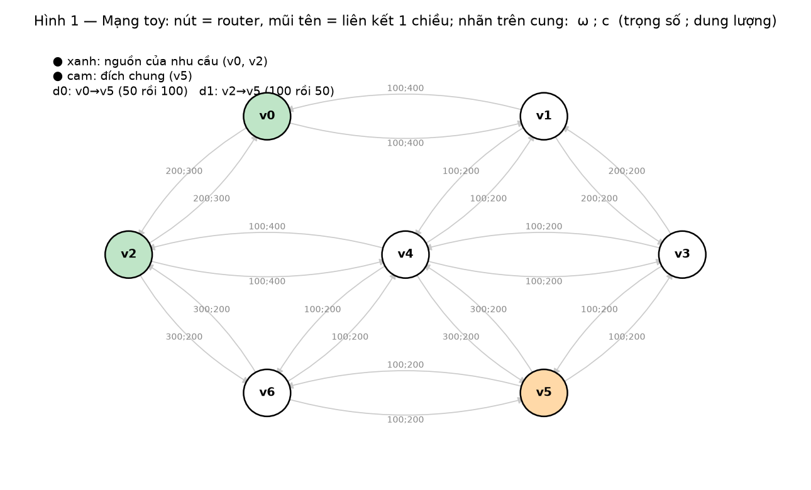
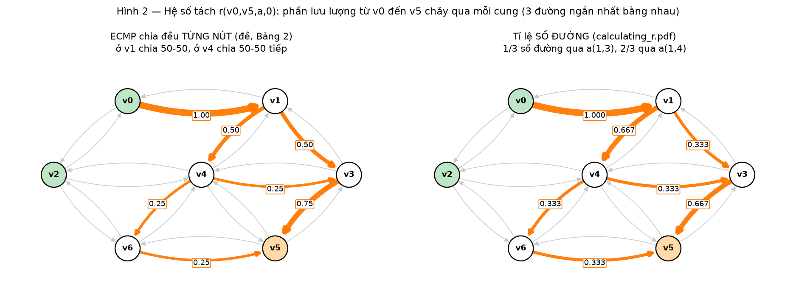
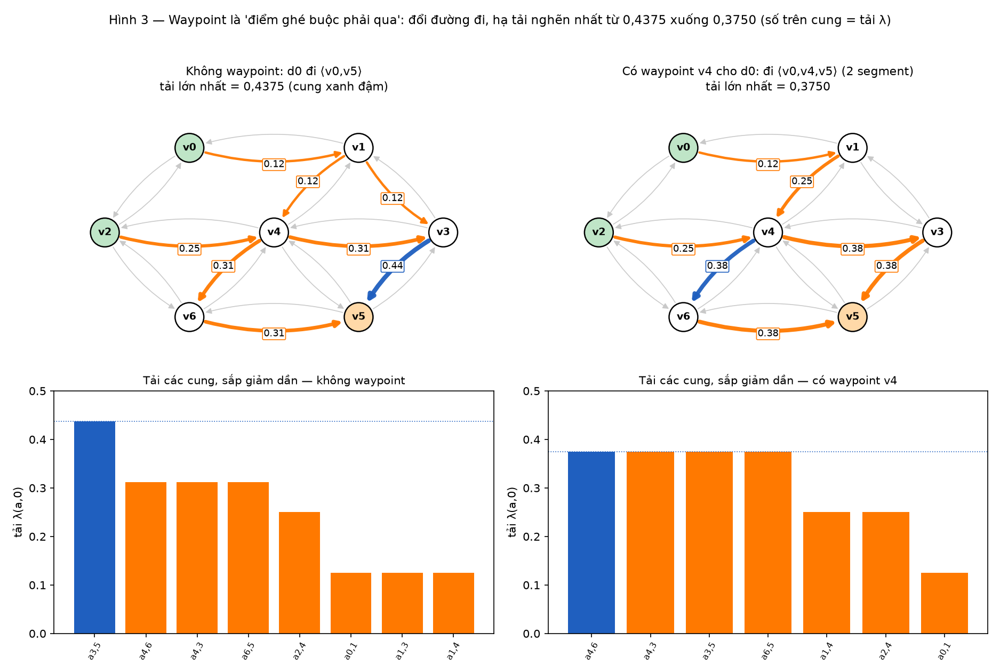
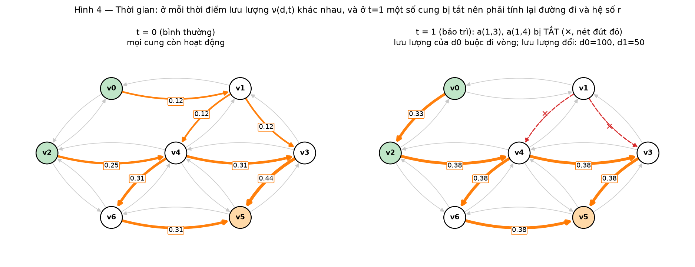
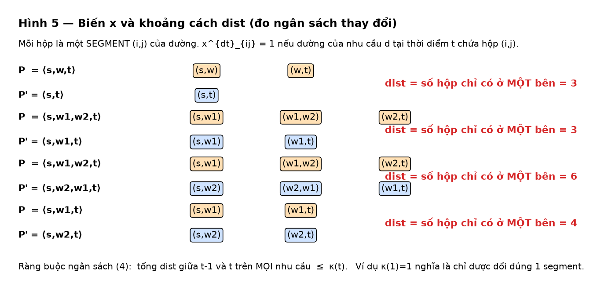

# Hình dung bài toán T-ASR qua hình vẽ

> **Cách xem:** mở file này trong VS Code rồi bấm `Ctrl+Shift+V` (xem trước Markdown) để thấy hình. Mọi hình vẽ từ **ví dụ toy trong đề** và các con số được **tính lại bằng code** (khớp đề: $0{,}4375 \to 0{,}3750$, $\lambda(a_{4,6},0)=0{,}3125$).
> Định nghĩa chính xác từng ký hiệu và công thức: `project/DINH_NGHIA_BAI_TOAN_VA_YEU_CAU_THAY.md`. File này chỉ giúp bạn **thấy** bài toán.

---

## 1. Hình dung bằng chuyện đời thường

Hãy nghĩ tới **mạng đường phố một chiều**:
- **nút** = ngã tư; **cung** = đoạn đường một chiều; mỗi đoạn có **chiều dài** $\omega$ và **sức chứa** $c$ (số xe tối đa).
- **nhu cầu** = một công ty cần chuyển một lượng hàng từ kho $s$ đến cửa hàng $\tau$; lượng hàng **thay đổi theo giờ**.
- Mặc định xe **đi đường ngắn nhất**. Nếu có nhiều đường ngắn bằng nhau thì xe **chia đều** ra các ngả (**ECMP**).
- Có thể **bắt xe ghé một ngã tư trung gian** trước khi đi tiếp: đó là **waypoint**. Giữa hai điểm ghé, xe vẫn đi đường ngắn nhất.
- **Tắc đường** = tải cao: tải của một đoạn $=$ lượng xe đi qua $/$ sức chứa. Cái ta sợ nhất là **đoạn bị dồn quá nhiều xe**.
- Có **kế hoạch sửa đường**: đến giờ $t=1$ một vài đoạn **bị đóng**. Ta phải sắp lại lộ trình, nhưng **mỗi lần đổi lộ trình tốn công** nên có **ngân sách** số lần đổi.

**Mục tiêu:** chọn các điểm ghé (waypoint) cho từng nhu cầu, từng giờ, sao cho **đoạn đường nặng nhất càng nhẹ càng tốt** (rồi đoạn nặng thứ hai, thứ ba...), không vượt ngân sách thay đổi.

*Hình 6 — Đọc từ trái sang phải, từ trên xuống: (1) đầu vào, (2) hệ số $r$ tính sẵn, (3) cái ta chọn, (4) ràng buộc, (5) cái ta đo, (6) mục tiêu.*

---

## 2. Ví dụ nhỏ: mạng toy

7 router ($v_0,\dots,v_6$), 22 liên kết một chiều. Có **2 nhu cầu** đều đi về $v_5$: $d_0=(v_0\to v_5)$ và $d_1=(v_2\to v_5)$.

*Hình 1 — Nhãn $\omega;c$ trên mỗi cung. Nút xanh là nguồn, nút cam là đích.*

Lưu lượng theo thời gian: $\nu(d_0,0)=50,\ \nu(d_0,1)=100;\ \ \nu(d_1,0)=100,\ \nu(d_1,1)=50$.

---

## 3. Lưu lượng chia ngả thế nào? (hệ số tách $r$)

Từ $v_0$ đến $v_5$ có **3 đường ngắn nhất bằng nhau** (độ dài 400). Hệ số $r(v_0,v_5,a,0)$ cho biết **bao nhiêu phần** lưu lượng đi qua cung $a$.

*Hình 2 — Bên trái: ECMP của đề, chia **đều tại từng ngã tư**: ở $v_1$ chia 50-50 (nên $0{,}5$ và $0{,}5$), ở $v_4$ chia 50-50 tiếp (nên $0{,}25$ và $0{,}25$). Bên phải: công thức của `calculating_r.pdf`, **đếm số đường**: trong 3 đường có 1 đường qua $a_{1,3}$ (nên $1/3$), 2 đường qua $a_{1,4}$ (nên $2/3$).*

**Điều quan trọng:** hai cách cho số khác nhau (ở ví dụ toy: $0{,}5$ so với $0{,}333$). Trên dữ liệu SetA hai cách trùng nhau ở 18/20 instance. Nhóm dùng cách **đếm đường** vì readme của thầy bảo đọc `calculating_r.pdf` để tính $r$.

---

## 4. Waypoint làm gì? (cái ta điều chỉnh)

Nếu $d_0$ đi thẳng theo đường ngắn nhất (không waypoint), cung $a_{3,5}$ chịu tải **$0{,}4375$** — cao nhất. Nếu **bắt $d_0$ ghé $v_4$** (đường $\langle v_0,v_4,v_5\rangle$, gồm **2 segment**: $v_0\to v_4$ rồi $v_4\to v_5$) thì lưu lượng chảy khác đi và tải cao nhất chỉ còn **$0{,}3750$**.

*Hình 3 — Hàng trên: tải $\lambda$ của từng cung (số trong ô), cung xanh đậm là nặng nhất. Hàng dưới: cùng các tải đó, **sắp giảm dần** — đây chính là vector mà mục tiêu muốn "hạ từ đầu cột bên trái".*

Đánh đổi: cung nặng nhất $a_{3,5}$ giảm từ $0{,}4375$ xuống $0{,}375$, còn vài cung khác **tăng** tải (ví dụ $a_{4,6}$, $a_{4,3}$, $a_{6,5}$ từ $0{,}3125$ lên $0{,}375$). Tải được **dàn đều** hơn, đúng điều ta muốn.

---

## 5. Thêm thời gian và sự cố

Ở $t=1$: lưu lượng đổi, và hai cung $a_{1,3}$, $a_{1,4}$ **bị tắt**. Lộ trình cũ của $d_0$ không còn dùng được nên phải **tính lại** đường đi và cả hệ số $r$ trên đồ thị đã bỏ các cung tắt.

*Hình 4 — Trái: $t=0$ bình thường. Phải: $t=1$, hai cung đỏ nét đứt bị tắt, lưu lượng của $d_0$ buộc đi vòng qua $v_2$.*

---

## 6. "Ngân sách" đo bằng gì? Biến $x$ là gì?

Ta mô hình hoá bằng biến nhị phân $x^{dt}_{ij}\in\{0,1\}$: **nhu cầu $d$ tại thời điểm $t$ có dùng segment $(i,j)$ hay không**. Đường $\langle s,w,t\rangle$ ứng với hai biến bằng 1: $x_{sw}$ và $x_{wt}$.
Ngân sách đếm **số segment khác nhau** giữa lộ trình ở $t-1$ và $t$:

*Hình 5 — Mỗi hộp là một segment. $\mathrm{dist}$ là số hộp chỉ có ở **một** trong hai lộ trình. Đổi $\langle s,w_1,w_2,t\rangle$ thành $\langle s,w_2,w_1,t\rangle$ tốn tới 6, vì **cả 3 segment** đều đổi. Bốn dòng là các ví dụ trong đề (Bảng 1).*

---

## 7. Tóm tắt trong năm câu

1. Có một mạng, vài nhu cầu, lưu lượng theo thời gian; ở $t\ge1$ một số cung bị tắt.
2. Với mỗi nhu cầu và mỗi thời điểm, ta **chọn dãy waypoint** (tối đa $\texttt{maxSeg}$ segment; SetA: 6).
3. Chọn xong, **tải mỗi cung** được tính từ hệ số $r$ (tính sẵn) nhân lưu lượng, chia dung lượng.
4. **Ràng buộc:** mỗi nhu cầu một đường nối đúng nguồn–đích; không quá $\texttt{maxSeg}$ segment; đổi cấu hình giữa hai thời điểm không quá $\kappa(t)$.
5. **Mục tiêu:** hạ cung nặng nhất, rồi nặng nhì... (thứ tự từ điển). Nhóm làm đúng hạng đầu (hạ MLU) bằng MILP, và có thêm cài đặt từ điển chính xác cho $K$ hạng đầu.

**Vì sao khó:** số biến $x$ là $\lvert D\rvert\cdot n(n-1)\cdot\lvert T\rvert$; với instance lớn lên tới gần $10^9$, nên nhóm dùng thêm mô hình thu hẹp "tối đa 1 waypoint" cho các instance lớn.
